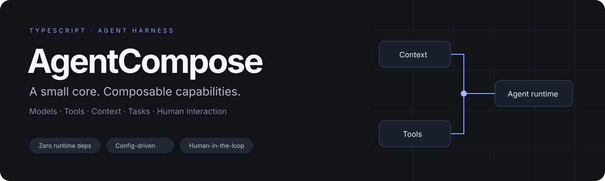
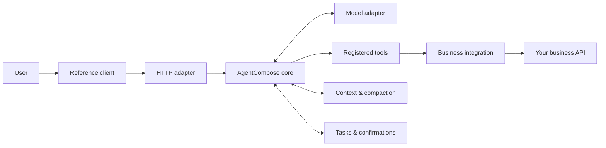

<p align="center"></p>

<p align="center">
  <a href="https://github.com/abandon1a2b/agent-compose/actions/workflows/ci.yml"></a>
  
  
  
  
</p>

<p align="center"><strong>A lightweight TypeScript agent harness for tools, context, tasks, and human interaction.</strong><br/>Compose business capabilities around a small, explicit execution core.</p>

<p align="center"><strong>English</strong> · <a href="README.zh-CN.md">简体中文</a> · <a href="#quick-start">Quick start</a> · <a href="docs/protocol.md">API & interaction protocol</a> · <a href="#architecture">Architecture</a></p>

---

## What it does

AgentCompose connects a model to registered tools, manages conversation context, and lets users participate through model-authored forms and confirmation cards. Business integrations stay outside the core.

The included reference app uses **DeepSeek** and a content-publishing demo. The runtime accepts an injected `Model`, `Tool[]`, and `TaskExecutor`; the demo is one composition, not the framework's domain.

| Capability | Implementation |
| --- | --- |
| **Tool execution** | Registered tools, structured results, bounded loops and cancellation signals |
| **Streaming** | Incremental model text and tool progress over an HTTP event stream |
| **Context compaction** | Configurable input-budget ratios; preserves complete recent turns |
| **Tasks** | Versioned drafts, pause/switch/resume, executor bindings and configuration versions |
| **Human interaction** | Model-authored questions, forms and version-bound confirmations |
| **Images** | Local upload, previews and multimodal messages through the DeepSeek adapter |
| **Configuration** | Validated JSON application definitions and runtime policies |
| **Separation of concerns** | Core, integrations and reference clients have distinct directories |

> **Status:** an experimental, single-process implementation for local development. Sessions, tasks, interactions and uploaded images are in memory. Production persistence, authentication and distributed execution are not implemented.

## Quick start

**Requirements:** Node.js **22.18+** and npm. Node runs TypeScript directly; no build step or runtime package installation is required beyond the project's development tooling.

```bash
git clone https://github.com/abandon1a2b/agent-compose.git
cd agent-compose
npm ci
 cp .env.example .env
```

Set your own `DEEPSEEK_API_KEY` in `.env`, then run:

```bash
npm run dev
```

Open **[http://127.0.0.1:4318](http://127.0.0.1:4318)**.

`npm start` runs without file watching. Both commands start the reference chat page and the Harness API on the same port. Use only one at a time.

For an **offline smoke check** without a model key:

```bash
MODEL_MODE=mock npm run dev
```

Mock mode supports basic text/history and time-tool checks. It does not replace a real model's language understanding, vision or form generation.

### Try it

- **Tool chaining:** “For this renovation case, calculate 29 items at 137 each, plus 41 delivery, using the calculation tool.”
- **Image input:** attach a PNG, JPEG or WebP interior photo and ask the model to describe it.
- **Interactive forms:** ask for a form with a city text field and an area number field.
- **Task switching:** select a demo publishing task, then ask to switch to the other task.

The bundled application has a Chinese-language business scope. Edit [`configs/applications/decoration.json`](configs/applications/decoration.json) to change its role, scope or presets.

By default, publication is **simulated**. An optional local content service can be connected with `CONTENT_SERVICE_URL`; it is not bundled in this repository. See [the adapter contract](docs/content-service.md).

## Architecture



```text
src/                           Core execution, protocols and included infrastructure adapters
  loop.ts                      Model → tools → model
  chat.ts                      Conversation orchestration
  compression.ts               Context compaction
  interactions.ts              Questions, forms and confirmations
  tasks/                       Generic task state and execution contracts
  config/                      Configuration validation and versioning
configs/
  runtime.json                 Execution and context policies
  applications/decoration.json Sample business application
integrations/content-service/  Optional publishing adapter and Mock implementation
examples/
  local-app.ts                 Composition root for npm start / npm run dev
  chat-ui/                     Reference browser client
test/                         Unit, protocol and integration tests
```

**Dependency direction:** examples compose integrations and core; integrations implement core interfaces. The core does not import business definitions or the standalone content service.

The included DeepSeek, HTTP and in-memory image implementations are infrastructure adapters within `src/`; this project does not yet split them into separately distributed packages.

## Configuration over business branches

[`configs/runtime.json`](configs/runtime.json) controls execution limits, timeouts, interaction types and compaction:

```json
{
  "maxModelSteps": 6,
  "requestTimeoutMs": 60000,
  "interaction": {
    "stopOnAwaitingUser": true,
    "allowedKinds": ["question", "form", "confirmation"],
    "maxFormFields": 6
  }
}
```

*Excerpt only; use the complete file in the repository.*

Application configuration defines role, allowed topics, task fields and executor names. Actual API calls belong in integration code. Unknown keys, invalid limits and unknown executor registrations fail at startup.

- `HARNESS_RUNTIME_CONFIG` and `HARNESS_APPLICATION_CONFIG` select alternate files.
- Secrets, model endpoint and deployment addresses stay in environment variables.
- Configurations are loaded as immutable startup snapshots and assigned a version hash.
- **Restart after editing JSON configuration.** Current tasks are not migrated across restarts.
- Topic restrictions are prompt-based, not a guaranteed semantic firewall.

## Model-authored interaction, trusted execution

The model can request a form using a constrained protocol:

```json
{
  "kind": "form",
  "title": "Tell me about your space",
  "fields": [
    { "id": "city", "type": "text", "label": "City", "required": true },
    { "id": "area", "type": "number", "label": "Area", "unit": "m²", "min": 0.01, "required": true }
  ],
  "submitLabel": "Continue"
}
```

The reference client renders allowed controls. The server validates replies against the stored definition and returns structured user input to the conversation.

**Submitting information is not authorization to execute.** Confirmation binds to the actual task revision and actor. Changing or switching a task invalidates earlier pending approval. Code-registered execution capabilities cannot be weakened by application configuration.

Generating a waiting interaction can end the current turn immediately, avoiding an extra model call just to announce that a card was created.

## Extend the runtime

```ts
import { createChatHandler, createHttpServer, type Model, type Tool } from './src/index.ts';

const tools: Tool[] = [{
  name: 'lookup_status',
  description: 'Read the current service status.',
  parameters: { type: 'object', properties: {}, additionalProperties: false },
  execute: async (_input, signal) => {
    signal.throwIfAborted();
    return { status: 'ready' };
  },
}];

// Supply an implementation of the Model interface.
export function serve(model: Model) {
  const chat = createChatHandler(model, tools);
  return createHttpServer(chat, 'custom').listen(4318, '127.0.0.1');
}
```

Importing `src/index.ts` does not start a server. Business operations implement [`TaskExecutor`](src/tasks/executor.ts), which returns a generic result rather than requiring publishing-specific identifiers.

## Development

```bash
npm run check
npm test
```

Tests use local fixtures and protocol stubs; they do not require a real model key. They cover tools, streaming, compaction, form replies, version-bound confirmation, configuration validation and task switching.

## Current boundaries

- **In-memory state:** server restarts invalidate sessions, tasks, approvals and image references.
- **Local-only reference server:** no production authentication or multi-tenant identity layer.
- **No distributed workers or durable recovery:** external side effects must implement their own idempotency.
- **Estimated token budgets:** compaction uses a heuristic, not an exact provider tokenizer.
- **Lossy summaries:** preserve recent turns and validate important information with users.
- **Image limits:** four images per message, 2 MB each; PNG/JPEG/WebP/GIF/AVIF, 64 MB process cache.
- **Cooperative cancellation:** custom tools must respect their `AbortSignal`.

These are explicit prototype boundaries, not production guarantees.
