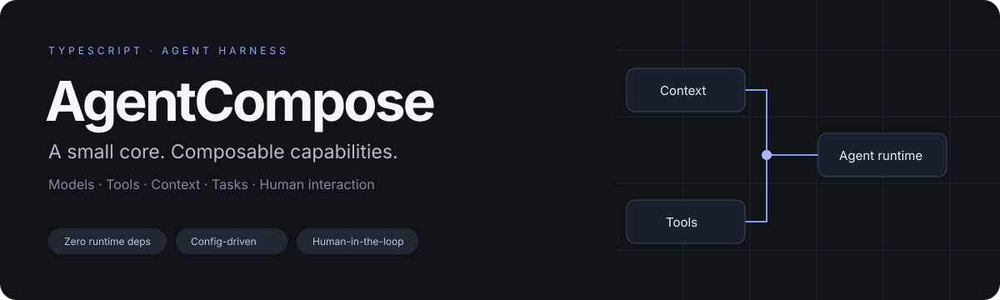

<p align="center"></p>

<p align="center"><strong>轻量的 TypeScript Agent Harness</strong><br/>把工具、上下文、任务和人机交互组合成业务 Agent。</p>
<p align="center"><a href="README.md">English</a> · <strong>简体中文</strong> · <a href="docs/protocol.md">接口协议</a></p>

## 核心能力

| 能力 | 实现 |
| --- | --- |
| 工具循环 | 模型 → 注册工具 → 模型，具备轮数限制和取消信号 |
| 流式输出 | 增量文本、工具进度、完成与错误事件 |
| 上下文压缩 | 按模型输入预算占比触发，保留最近完整回合 |
| 任务管理 | 草稿版本、暂停/切换/恢复、确认与执行 |
| 模型生成交互 | 问题、表单、确认卡片；不执行模型生成的HTML |
| 图片输入 | 上传、预览、多模态消息 |
| 配置驱动 | 角色、业务范围、字段、执行器和运行策略由JSON定义 |
| 业务隔离 | 核心、业务适配器、验证页面分开维护 |

**当前定位是本地验证与开发原型。** 会话、任务和附件仍在内存；尚未实现持久化、生产认证、集群执行或可靠故障恢复。

## 快速启动

需要 Node.js **22.18+** 和 npm。没有第三方运行时依赖，开发依赖仅为 TypeScript 与 Node 类型。

```bash
git clone https://github.com/abandon1a2b/agent-compose.git
cd agent-compose
npm ci
cp .env.example .env
```

在 `.env` 填入自己的 `DEEPSEEK_API_KEY`，然后：

```bash
npm run dev
```

打开 **http://127.0.0.1:4318/**。页面和API共用端口。`npm start` 为非监听模式，两者选一个启动。

不使用真实模型时可运行：

```bash
MODEL_MODE=mock npm run dev
```

Mock 只用于文本、历史与时间工具的基础流程检查，不等于真实模型的理解、视觉或表单生成能力。

默认内容发布为模拟模式。需要接本地业务服务时再填写 `CONTENT_SERVICE_URL`；独立内容服务未包含在此仓库，接口约定见 [内容服务适配说明](docs/content-service.md)。

## 边界设计

```text
src/                            核心协议、循环、任务及内置基础设施适配
configs/runtime.json            通用运行策略
configs/applications/           业务角色、范围、预设和字段
integrations/content-service/   可替换的发布工具适配与Mock实现
examples/local-app.ts           验证应用启动入口
examples/chat-ui/               验证聊天页面
```

依赖方向：**示例组合核心与适配器，适配器实现核心接口，核心不导入业务服务或装修定义。**

模型决定何时提问、收集哪些信息、生成什么交互；服务端掌握字段校验、会话归属、草稿版本和执行授权。提交表单只是提供信息，不代表授权发布。

新增业务时，增加配置与执行器实现，复用现有循环、表单协议和确认机制。发布编号、业务URL等结果由适配器返回，不是核心必需字段。

## 配置

- [runtime.json](configs/runtime.json)：轮数、超时、交互策略、输入预算和压缩。
- [decoration.json](configs/applications/decoration.json)：示例业务角色、话题范围、任务字段、切换策略、执行器名称。
- `.env`：密钥、模型地址、端口和环境相关配置。

启动时严格校验配置并生成版本快照。**修改JSON后需要重启服务**；目前不热更新，也不迁移旧的内存任务。

业务话题范围是提示词软约束，不是严格语义拦截。需要确认的执行器由代码声明，配置不能降低其授权要求。

## 可以尝试

- “调用计算工具，先算137乘29，再加41。”
- 上传图片，请模型描述内容。
- “请生成城市和面积的回复表单，不填默认值。”
- 在示例任务中说“先不发案例了，改发文章”。

## 开发与测试

```bash
npm run check
npm test
```

测试使用本地桩和模拟执行器，不需要真实模型密钥。

## 当前限制

- 服务重启后，内存会话、任务、交互和图片引用失效。
- 验证服务仅监听本机，没有生产认证和租户隔离。
- 未实现分布式调度或持久任务恢复；外部写操作仍需下游幂等支持。
- token 计数是估算；历史摘要是有损归纳。
- 图片最多4张/消息、2MB/张，当前进程缓存上限64MB。
- 自定义工具必须配合 `AbortSignal` 才能及时取消。

当前内置模型适配为 DeepSeek；HTTP与内存图片实现仍在 `src/` 内，尚未全部拆成独立发布包。这里不宣称已经是生产级、完全供应商无关的平台。
